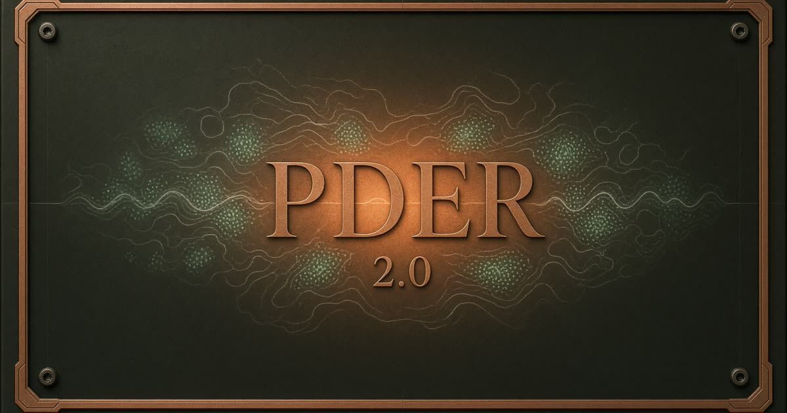

# PDER 2.0

A browser laboratory for partial differential equations.

PDER 1.0 was a 2015 computer-engineering senior design at the University of Tennessee: a FLTK and MathGL desktop program that parsed a `.pde` file, built gradient, curl, divergence, and a laplacian, and stepped scalar and vector fields on a 100³ grid. The source is still at [jdorris1331/PDER-1.0](https://github.com/jdorris1331/PDER-1.0). The user's manual ended at "under construction."

2.0 keeps that language and replaces the unfinished desktop lab with something you can actually run: stable schemes, an exact-solution overlay, paint-on initial conditions, a spacetime film strip, and a script bench that still accepts the original assignment form.



## Run it

```bash
npm install
npm test
npm run dev
```

Open the URL Vite prints. `npm run build` writes a static site to `dist/`.

The last bench and script you had open are remembered in this browser (`localStorage`). Nothing is uploaded.

## Benches

| Bench | What you should see |
| --- | --- |
| Diffusion–decay | The `problem3.pde` scalar system. Two hot spots spread and fade. |
| Heat equation | A sine on a cold rod, with the Fourier solution drawn on top. |
| Hot plate | Paint heat. Cold edges drink it. |
| Vibrating string | Pluck it. Lower the wave speed and the pitch drops. |
| Drumhead | Tap a square membrane. A little damping keeps it from ringing forever. |
| Burgers shock | A sine steepens into a front. Viscosity sets how thick it stays. |
| Allen–Cahn | Random seeds coarsen into domains of +1 and −1. |
| Gray–Scott | Feed and kill sliders walk through spots, coral, worms, and mitosis. |
| Excitable pulse | A broken front curls into a Barkley spiral. |
| Barrier packet | A Gaussian wave packet splits on a rectangular barrier. |
| Electrostatics | Click to drop charge. The potential relaxes by SOR. |
| Ink in water | Drag to stir. Stam's stable fluids, with dye. |
| Script bench | Paste a 1.0 file, or write a derivative. |

Paint with the pointer. Space plays and pauses. The badge under the field is the stability readout (CFL, blow-up, L2 against an exact solution when one exists).

## Scripts

Derivative form, updated simultaneously:

```text
param k = 4
field u
u = gauss(0.35, 0.5, 0.08)
u' = lap(u) / k
```

PDER 1.0 assignment form still works. `laplac()` is the original wide `div(grad)` stencil in grid units — it is not divided by Δx². `lap()` is the five-point stencil, also in grid units, which is what the 2015 lab was reaching for.

```text
scalar box1
box1 = 0
dbox1 = laplac(box1)
box1 = box1 + dbox1 / k
```

Other calls: `dx`, `dy`, `grad` magnitude, `gauss(x, y, sigma)`, `noise(scale)`, `rand()`. Constants declared with `param` become sliders.

## What is inside

The solvers live in `src/lib/pde/` and do not depend on React. `npm test` checks the 2015 diffusion seed, heat against the exact sine, wave energy, the Burgers front, Gray–Scott staying bounded, the packet's norm and drift, Poisson, the ink field, and an FFT round trip.

Schemes, on purpose and named in the UI: FTCS, leapfrog, upwind Burgers, explicit reaction–diffusion, split-step Fourier, successive over-relaxation, and Jos Stam's stable-fluids projection.

## License

Apache License 2.0, same family as PDER 1.0. Copyright 2026 Joseph Dorris.
